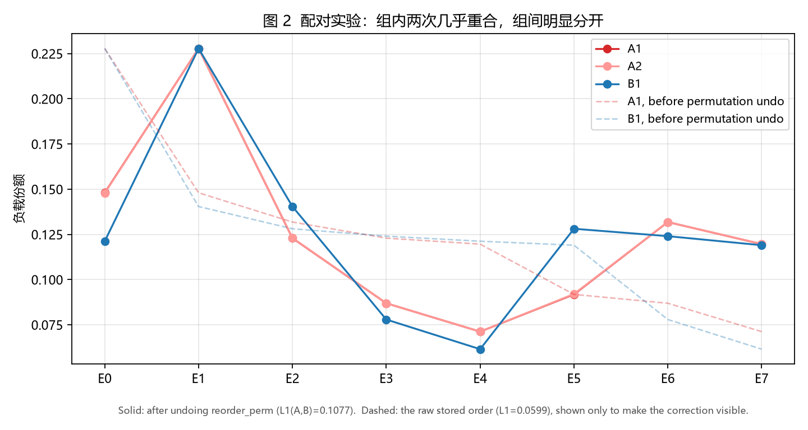
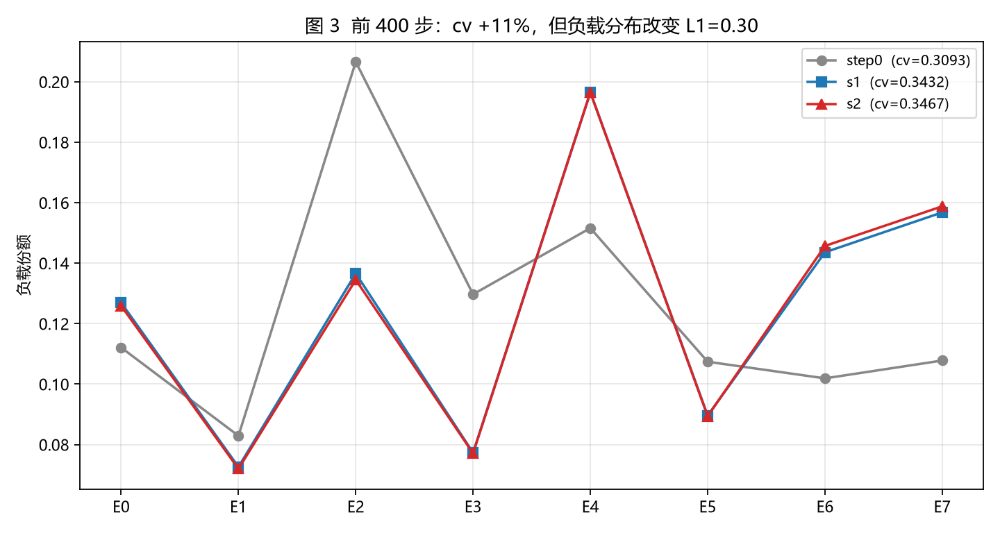
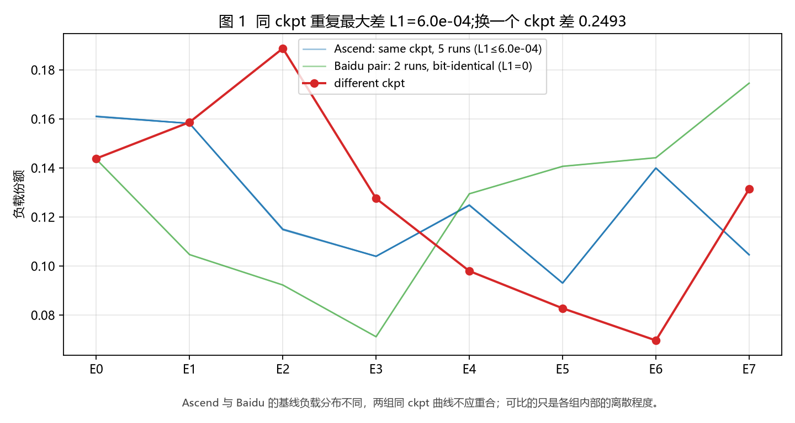

# moe-load-metrics

> Chinese version: [README.md](README.md)

> **This release (2026-11-20) corrects two previously published numbers:**
> the `L1` intervention effect **0.0599 → 0.1077**, and the `L1` ckpt-switch difference **0.1025 → 0.2493**.
> Reason: the old values were computed **without undoing `reorder_perm`**; every `L1` in this document is now
> computed after restoring the original expert order. The direction of the conclusions is unchanged, and stronger
> (see notes ③ and ⑤, and `PITFALLS` item 17).

## MoE Expert-Load Metrics: A Precision Comparison of cv and L1

> A small experiment about **metric choice**.
> No methods on offer — it answers one question: **is the ruler you use to judge MoE routing any good?**

---

## Abstract

MoE training papers commonly argue that load balancing is working well by citing the
**coefficient of variation (cv) of expert load**.
We ran three controlled experiments on a 1.2B / 8-expert / top_k=2 model and observed:

1. **Under a single intervention, the change in cv is not proportional to the change in L1** — in the paired experiment cv differs by only 1.4%
   (~19× its own noise), while L1 differs by 0.1077 (~215× the difference between two repeats);
   in the long run, cv changes by 11% yet corresponds to L1 0.30, and a 1% change corresponds to L1 0.016 — **there is no stable ratio**
2. **cv is a scalar: it compresses away the shape of the distribution** — `abN3_r2_s1` has cv **0.3555** and a load range of **2.50×**;
   `ag_dose_g02` has cv **0.2833** and a range of **3.11×**.
   **The one with the lower cv has the larger range — the two scalars describe different aspects, and they do not rank the same way.**
3. **Switch to another ckpt and the load distribution differs by 0.25 (L1)** — larger than any intervention effect we measured
   (intervention effect 0.1077, same-ckpt noise on the order of 1e-4)

**Conclusion: comparing routing metrics across runs is unreliable, and mainly not because "training is stochastic",
but because "every training run is a different ckpt". And once the ckpt is fixed, cv still cannot reflect who carries the load — **it is completely invariant to reordering the experts**.**

---

## Repository Layout

```
README.md              this document
REPRODUCE.md           reproduction guide (three hard conditions + minimal steps)
PITFALLS.md            the pitfalls we ran into (22 items)
metrics.py             minimal implementation of cv / L1, runnable as is
make_figures.py        reproduces the three figures
check_pair.py          pre/post checks for the paired experiment (the package's main tool)
README.en.md           English version
data/                  experimental data (session cards + summary tables)
figures/               the three figures
LICENSE.md             CC BY 4.0 (data/text) + MIT (code)
AI-COLLABORATION.md    AI-collaboration statement (who did what, which mistakes the AI made)
PITFALLS.en.md         English version of PITFALLS.md
REPRODUCE.en.md        English version of REPRODUCE.md
REFERENCES.en.md       English version of REFERENCES.md
METRICS-SCOPE.md       supplement: what cv / entropy / top1 / L1 each do and do not see
```

> The tree's annotations are translated here; file and directory names are verbatim.

---

## 1. The Two Metrics

```python
cv(x)    = std(x) / mean(x)                      # degree of dispersion, dimensionless
L1(a, b) = sum(|a[i] - b[i]| for i in range(E))  # distance between two share distributions
                                                 # precondition: a and b are share vectors summing to 1, range 0~2
```

> The actual `metrics.py` in this repository has Chinese comments; the block above is translated for readability.

| Metric | Under permutation | What it reflects | Units |
|---|---|---|---|
| **cv** | **permutation-invariant (insensitive)** | the **degree** of imbalance | dimensionless |
| **L1** | **sensitive** | **who** carries the load | share (0~2) |

**"Expert 0 takes 40% / expert 7 takes 5%" and "expert 0 takes 5% / expert 7 takes 40%" have exactly the same cv.**

---

## 2. Three Pieces of Evidence

### Platforms

| Platform | Accelerator | Software stack | Platform characteristics relevant here |
|---|---|---|---|
| AtomGit | Ascend 910B4 (32 GB HBM) | PyTorch 2.9.0 + torch_npu 2.9.0, CANN 8.5.0 | 1e-4~6e-4 run-to-run non-determinism |
| Baidu AI Studio | Iluvatar BI-V150S (32 GB) | PyTorch 2.4.1 + corex, IX-ML 4.3.8 | **bit-deterministic**; fp64 statistics are 0 (see note ①) |

> These two platform properties directly support two claims in this document:
> ① **the noise floor is a property of the platform** → signal-to-noise ratios are not comparable across platforms (see §3);
> ② fp64 statistics on Baidu are 0 → `RouteStats` now uses int64/fp32 counters (see note ① and PITFALLS item 7).

> **Note ① (a record of what we observed, not a claim about the platform)**
> Under the platform configuration given in this repository, when we computed load statistics with `torch.float64`
> the results were always 0 and no exception was raised. **We have not located the root cause** —
> it may come from the environment, the driver, a library version, or from how this repository uses them.
> **We make no assertion about the platform on this basis; please open an issue if you need reproduction details or a minimal case.**
>
> **This does not affect any conclusion in this document**: `RouteStats` has been switched to `int64`/`float32` counters,
> so all metrics **bypass the fp64 path** (see PITFALLS item 7).

Measured throughput (2048×2048 matrix multiply, not nominal values): Ascend bf16 207.9 TFLOPS; BI-V150S bf16 92.6 TFLOPS.

### 2.1 Paired: one intervention moves cv by 1.4% but moves L1 by 215× the noise

> **Data date**: 2026-11-17 (Ascend) | **Conditions**: fixed ckpt (one file, copied twice) | single platform.
> Raw cards in `data/session_cards/card_pair2*`.

We copied the same ckpt twice, added 0.2 to the router bias in one copy and left the other untouched, and trained each for 129 steps (`pair2A/2B` both go 127→256).

| | L1 | cv |
|---|---|---|
| intervention vs no intervention | **0.1077** | 0.3899 vs 0.3955 (difference 0.0056, i.e. 1.4% relative) |
| **this group's own noise** (A1 vs A2, two independent runs) | **0.0005** | **0.0003** |
| reference: another group, 5 repeats | 0.0001 ~ 0.0006 | range 0.0004 (that group's cv≈0.205) |
| **signal-to-noise ratio** (effect ÷ this group's own noise) | **215×** (0.1077 ÷ 0.0005) | **~19×** (0.0056 ÷ 0.0003) |

> **Note the denominator**: the "within-group noise" of both L1 and cv is taken as **this group's own difference between two repeats**
> (A1 vs A2); we do not mix in the 0.0004 of the other group (the one with cv≈0.205) — the two differ in cv magnitude, and mixing them would give the wrong ratio.




**This is the hardest piece of evidence in this document**: the two groups start from an identical point, the only difference is those 8 bias numbers,
and yet L1 amplifies the difference 215×, while cv amplifies it only 19× (a change of 0.0056, i.e. 1.4% relative).

### 2.2 Dose curve: an interior optimum exists, and "overshoot" has a measured point

> **Data date**: Ascend 2026-11-17; Baidu 2026-11-18 | **Conditions**: fixed ckpt | two platforms.
> Raw cards in `data/session_cards/card_dose_*` and `card_baidu_d*`.

We scanned gamma on the same ckpt (96 steps each):

| Platform | Control cv (same window) | γ=0.1 | γ=0.2 | γ=0.4 | γ=0.8 | Shape |
|---|---|---|---|---|---|---|
| Ascend | 0.1978 | **0.1125** | 0.1287 | 0.1639 | — | U-shaped, minimum at 0.1, overshoot by 0.4 |
| Baidu | **0.2674** | 0.2420 | 0.2173 | **0.1456** | **0.3229** | U-shaped, minimum at 0.4, severe overshoot at 0.8 |

**Note the 0.8 cell: cv = 0.3229, which is 20.8% worse than no intervention (0.2674).**
⇒ **Overshoot is not "the improvement getting weaker"; it is "the intervention itself creating a new imbalance".**

> ⚠️ **Each of the two platforms is U-shaped, but the optimal positions differ by 4×.**
> **We cannot conclude from this that "U-shape is a cross-platform regularity"** — the baselines behind the two controls are in different states, see Section 5.
> The two sides also differ in **baseline imbalance** (cv 0.19 vs 0.27), and **this experiment does not disentangle platform from control**.

### 2.3 Long training: cv and L1 move in the same direction, but not proportionally

> **Data date**: 2026-11-16 (Ascend, 800 steps) | **Conditions**: two sessions of a single run (same ckpt chain) | single platform.
> Raw cards in `card_ag_long_s1/s2`.

> **Note ② (data provenance)**: the 8-dimensional expert-load array for `step0` in this section (used to compute L1 = 0.3009)
> survives only in `data_for_figures.json`; **there is no corresponding raw session card**, so it is summary-layer data.
> Please check against that file; every other datum has a card. **This is the only place in this document where the first-level provenance is missing.**

**Experimental conditions (required for reproduction)**: `router_mode=none`.
The `none` mode does not call `reorder_experts`, so `expert_load` keeps the **original index order**.
Under the `sber` mode, the reorder at the end of the session permutes the array in descending load order — **the phenomenon then cannot be observed directly**.

800 training steps (this run consumed 53.54 M tokens):

| Interval | cv change | L1 |
|---|---|---|
| first 400 steps (step0 → s1) | 0.3093 → 0.3432 (**+11%**) | **0.3009** |
| last 400 steps (s1 → s2) | 0.3432 → 0.3465 (**+1%**) | **0.0164**<br>(card value 0.0082, see note ③) |

> **Note ③ (the statistical scope of `s2`)**: `s2` was continued from `s1`, so the `expert_load` in its card is
> **cumulative over (history + this session)** (408 steps of `s1` + 409 steps of this session), not this session alone.
> Back-solving with `sess/(base+sess) = 409/817 = 0.501` gives a **true L1 for this session of about 0.0164** (the card value 0.0082 × 2).
> `s1` was trained from scratch and **has no history**, so its `cv` and `L1` are unaffected.
>
> **⇒ The table in this section uses 0.0164 and notes the card's original value. This is the only number in this document that needs a scope correction.**



**An 11% change in cv corresponds to L1 0.30, and a 1% change to L1 0.016 — there is no stable proportional relationship between them.**
(Dividing the absolute change by the repeat range of cv, 4e-4: the 11% stretch is **85×**, the 1% stretch **41×**; both stretches exceed the noise.)

## 3. Precision: The Noise Ruler

> **Data date**: Ascend 2026-11-17 (5 repeats); Baidu 2026-11-18 (2 repeats).
> **Note**: an earlier measurement (2026-11-15) on a different configuration gave a cv fluctuation of ±20%;
> that batch **did not fix the ckpt**, so it should not be placed alongside this table — it shows that
> "runs are not comparable across runs", not "noise within the same ckpt".

| Setting | Conditions | L1 | cv |
|---|---|---|---|
| within one ckpt, Ascend 5 repeats | **fixed ckpt** / single platform | 0.0001 ~ 0.0006 | range 0.0004 |
| within one ckpt, Baidu 2 repeats | **fixed ckpt** / single platform | **0.0000 (bit-identical)** | identical |
| retrain the baseline once | **across runs** / single platform | **0.2493 (N=1)<br>0.5638 (N=1, another pair of runs)** | — |
| ~~cv ±20% (2026-11-15)~~ | **across runs** / ckpt not fixed | — | **±20%** (not to be placed alongside this table) |



> **Note ⑤ (where the second number, 0.5638, comes from)**:
> `L1(card_1118_base_a, card_1118_base_b) = 0.5638`.
> Both runs are `router_mode=none`, `0→130` steps, same seed and configuration,
> with `reorder_perm=null` (`none` mode does not reorder, so **no permutation undo is needed**).
> Both cards are in `data/session_cards/` and can be checked directly.
>
> **⚠️ This number says one thing only: two identically configured runs trained from scratch for 130 steps
> can differ by 0.5638 in load distribution.**
> **It is an observation about one pair of runs, not a "typical cross-run value".**
> (Their `cv` values are 0.4671 / 0.3516; 0.4671 is higher than every later base's `cv`,
> so it should be read as one sample from the tail.)


**⚠️ The provenance of 0.2493 (this must be stated)**:
it comes from `L1(rep5_rep1[130 steps], phase_pt130_a[128 steps])` — **the two windows differ by 2 steps**,
so strictly speaking it does not satisfy hard condition 2 of REPRODUCE in this package. **The contribution of the window mismatch is estimated from measurements inside the package**: `card_ceTime` (84 steps) / `ce85` (85 steps) / `ce96` (95 steps)
are three runs on the same baseline with the same seed (all status ok); measured, **a 1-step difference gives L1 ≈ 0.0005 and 10 steps ≈ 0.0024**
(~2.5e-4/step) ⇒ **2 steps is about 1e-3, i.e. about 1% of 0.2493**.
Estimating more conservatively from the slope over the first 408 steps (0.3009/408 ≈ 7.4e-4/step): 2 steps ≈ **1.5e-3 (1.5%)**.

**⇒ The conclusion is unaffected, but this number should be read as "an estimate containing at most ~1.5% window contamination", and we could not find a same-window pair.**

**⚠️ Two further points must be stated:**
1. **The level of reproducibility is a property of the platform**: Ascend has 1e-4~6e-4 of run-to-run noise,
   whereas the same code on Baidu is **bit-deterministic**. The "signal-to-noise ratios" in this document therefore hold only within their own platform and are **not comparable across platforms**.
2. **"A ckpt switch costs 0.25" was measured on only one pair** (different days, different instances); the direction is consistent but **N=1**.

---

## 4. A Side Result: the Bias Changes the Load Without Changing Task Quality

> **Data date**: Ascend 2026-11-17; Baidu 2026-11-18 | **Conditions**: fixed ckpt | two platforms.

| Platform | Intervention | cv | ce_ema |
|---|---|---|---|
| Ascend | 5 dose levels (0~0.4) | 0.1978 → 0.1125 (**-43%**) | spread **0.0002** (range across the five groups) |
| Baidu | bias 0 → 0.2 | 0.2674 → 0.2173 (**-19%**) | spread across six groups 9e-4 (noise 0) |

**On both platforms there is no measurable association between "load balance" and "language-modelling quality".**

---

## 5. An Unresolved Observation: the Optimal Dose Depends on the Baseline

> **Data date**: Ascend 2026-11-17; Baidu 2026-11-18 (including the 0.8 follow-up) | **Conditions**: fixed ckpt | two platforms.
> ⚠️ **Note**: this table is **not** evidence of a "platform difference" — the two sides use different controls, and the two variables, platform and control, are not disentangled.
>
> ⚠️ **Two different cv values on Baidu**: `card_baidu_base` is the cv after "the baseline ckpt trains for 130 steps itself", namely 0.2626;
> whereas the control for the dose scan is `c1/c2`, "run 96 more steps starting from that ckpt", namely **0.2674**.
> **The dose table may only use the same-window 0.2674**; 0.2626 cannot be placed alongside this table.

| Platform | Control cv (same window) | γ=0.1 | γ=0.2 | γ=0.4 | Shape |
|---|---|---|---|---|---|
| Ascend | 0.1978 | **0.1125** | 0.1287 | 0.1639 (overshoot already at 0.4) | U-shaped, minimum at 0.1 |
| Baidu | **0.2674** | 0.2420 | 0.2173 | **0.1456 (0.3229 at 0.8, severe overshoot)** | U-shaped, minimum at 0.4 |

**⚠️ Platform difference and baseline difference cannot be separated**: the imbalance of the two controls also differs (cv 0.19 vs 0.27),
**and this experiment does not disentangle the two factors.** Factors **partly ruled out**: router logit scale — the two sides are of the same order of magnitude but not equal (Ascend ~0.79, Baidu ~0.71),
**so we cannot attribute the difference entirely to scale, but we also cannot rule out that it contributes.**

**The most we can write is "the optimal gamma depends on the baseline state and must be calibrated per baseline"; we cannot write any quantitative rule.**

---

## 6. Related Work

### 6.0 Source of the Method (Required Reading)

The practice used here — "add a load-dependent bias to the router and push the load flat during training" —
is **aux-loss-free load balancing**, from the **DeepSeek-V3 technical report** (arXiv:2412.19437)
https://arxiv.org/abs/2412.19437

> See step 3 of REPRODUCE.md. **This document does not propose the method; it measures "which metric should be used to evaluate it".**


### 6.1 Independent evidence that routing is sensitive to training conditions

**[1] MoE Pretraining: Parallelism Layout Changes the Model, Not Quality** (arXiv:2611.15271, 2026-11-11)
https://arxiv.org/abs/2611.15271

That paper runs a set of experiments complementary to ours:
- **changing the parallelism layout** mid-training leaves **model quality unchanged** but **changes the model itself**
  (the final prediction difference is about **80%** of that from changing the seed, with **>90% of routing decisions flipped**);
- the flips concentrate in **near-tie tokens** (boundary samples);
- the **timing of the switch** matters: switching at 84% of pretraining has almost no effect.

**Relation to this document**: they show "change the parallelism layout → routing changes a lot, quality does not";
we show "**change the ckpt (same seed / same configuration / same data) → the load distribution differs by 0.25, which is larger than the intervention effect 0.11 we want to measure**".
Both point to the same thing: **routing state is extremely sensitive to training conditions, while task quality is not.**

> This also explains why we insist that "you must lock onto that one specific ckpt file" —
> changing the parallelism layout and running training once more are, in effect, disturbances of the same kind.

### 6.2 Irreproducibility of Routing Itself

**[2] Even under identical conditions, repeated forward passes can choose different experts** (arXiv:2510.11370)
https://arxiv.org/abs/2510.11370

That paper suggests recording the routing distribution and replaying it, rather than assuming the forward pass is deterministic.

**Relation to this document**: what we measured are **within one ckpt** differences that are extremely small
(Ascend 1e-4~6e-4; Baidu 0, bit-identical),
consistent with "even identical conditions can diverge" — **and we provide the magnitude**.

### 6.3 Claims We Did **Not** Adopt

This document does **not** claim that "some universal intervention strength exists". See the caveats in Section 5.

---

## 7. Reproduction Conditions (Three, All Mandatory)

1. **The same ckpt file** (not "the same seed")
2. **The same window length** (not "roughly the same")
3. **The intervention magnitude is computed on the fly from the current baseline's own load** (not reused from another baseline's value)

> We distilled these three after stepping in the pits ourselves. Omit them and reproduction will fail.

---

## 8. Limitations

| Item | Note |
|---|---|
| Scale | 1.2B / 8 experts / top_k=2 |
| **Method-version coverage** | We measure the **pure** aux-loss-free of the V3 era. From V4 on it became "aux-loss-free + a small amount of sequence-wise balance loss" (arXiv:2606.19348), and V4.1 further splits the bias per modality (arXiv:2609.19969) — **neither of these two variants was measured** |
| Data | A single corpus (56.35 M tokens; the original record reads 5635 in units of 10⁴); the long-training run actually consumed **53.54 M tokens** (original record 5354 in units of 10⁴, the two sessions added together) |
| Model extrapolation | **larger models / more experts not verified** |
| L1 of a ckpt switch | **N=1** (0.2493, spanning two days with a 2-step window difference) and **N=1** (0.5638, two identically configured runs)<br>**Two observations are not enough for a "typical cross-run value"** — we only claim that "anywhere from 0.25 to 0.56 is possible" |
| **Repeats on the same base** | **Not done.** The paired experiment (§2.1, `0.1077`) is a single run.<br>Reason: the ckpt that produced it was destroyed with the instance. **This is an inherent cost of the "ckpts are not persisted" experimental design**, not an oversight |
| Mechanism of the optimum | **undetermined** (**partly ruled out**: 0.79 vs 0.71, not fully attributed) |
| Comparability of SNR | Baidu noise 0 / Ascend 1e-4~6e-4, **not comparable across platforms** |

---

## 9. About This Material Itself

### 9.1 AI Collaboration

The code, experiment execution, analysis and writing in this repository were produced with the assistance of AI systems; humans were responsible for direction-setting and final review.
**The full account (including a record of the AI being proven wrong more than 10 times during this work) is in [AI-COLLABORATION.md](AI-COLLABORATION.md).**

> We chose to publish the AI's mistakes because **a narrative that never errs is more suspect than a process that errs and then checks itself.**

### 9.2 Reference Verification

The top of `REFERENCES.md` states the **scope of verification**: the titles and identifiers of all eight references were checked;
for the five actually cited in the body ([1]–[5]), the wording of their conclusions was compared against their abstracts;
the three background references had only their identifiers and titles checked, and their conclusions are not used in the body.
**Note**: the technical details of [4] V4 and [5] V4.1-Flash (sequence-wise balance loss, Sigmoid→Sqrt(Softplus)) are cited from their abstracts and have not been independently verified.

### 9.3 Corrections Welcome

This repository is **a work in progress, and we do not rule out that undiscovered errors remain**.
If you find a problem, please open an issue — that is better than letting the error spread.

## 10. If You Remember Only One Sentence

> **cv measures "how concentrated", L1 measures "who gets it".
> And every training run is a different ckpt — the difference from switching ckpts (0.25)
> is larger than the intervention effect you want to measure (0.11).**
