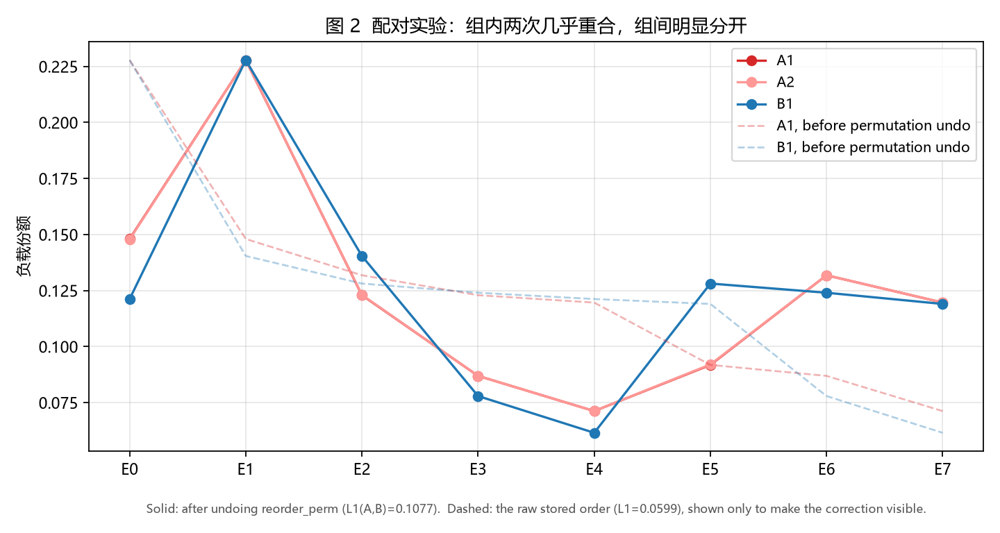
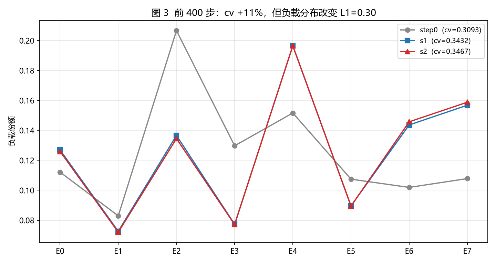
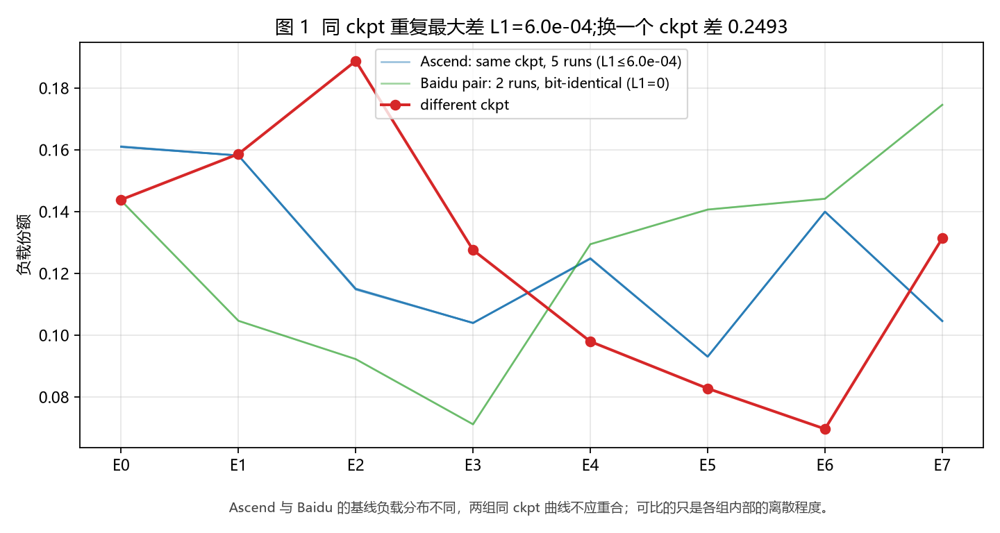

# moe-load-metrics

> English version: [README.en.md](README.en.md)

## MoE 专家负载指标：cv 与 L1 的精度对比

> 一个关于 **指标选择** 的小实验。
> 不讲方法，只回答一个问题：**你用来判断 MoE 路由好不好的那把尺子，准不准？**

---

## 摘要

MoE 训练里常用「专家负载的变异系数（cv）」论证负载均衡做得好。
我们在 1.2B / 8 专家 / top_k=2 的模型上做了三组对照实验，发现：

1. **同一次干预下，cv 的变化幅度与 L1 不成比例** —— 配对实验中 cv 只差 1.4%
   （约 19 倍自身噪声），而 L1 差 0.0599（约 120 倍两次重复之差）；
   长训练中 cv 变 11% 却对应 L1 0.30，变 1% 对应 L1 0.008 —— **没有稳定比例关系**
2. **cv 是一个标量，它压缩掉了分布形状** —— `abN3_r2_s1` 的 cv 为 **0.3555**、负载极差 **2.50 倍**；
   而 `ag_dose_g02` 的 cv 为 **0.2833**、极差 **3.11 倍**。
   **cv 更低的那个，极差反而更大 —— 两个标量描述的是不同侧面，排序并不一致。**
3. **换一个 ckpt，负载分布就差 0.10（L1）** —— 比任何我们测过的干预效应都大
   （干预效应 0.0599，同 ckpt 噪声 1e-4 量级）

**结论：跨 run 比较路由指标不可靠，主要不是因为"训练有随机性"，
而是因为"每次训练都是一个不同的 ckpt"。而固定 ckpt 之后，cv 依然无法反映负载落在谁身上 —— **它对专家重排完全不变**。**

---

## 仓库结构

```
README.md              本文
REPRODUCE.md           复现指南（三条硬条件 + 最小步骤）
PITFALLS.md            我们踩过的坑（12 条）
metrics.py             cv / L1 的最小实现，可直接跑
make_figures.py        复现三张图
check_pair.py          配对实验的事前/事后检查（本包主工具）
README.en.md           English version
data/                  实验数据（session card + 汇总表）
figures/               三张图
LICENSE.md             CC BY 4.0（数据/文字）+ MIT（代码）
AI-COLLABORATION.md    AI 协作声明（谁做了什么、AI 出过哪些错）
```

---

## 一、两个指标

```python
cv(x)    = std(x) / mean(x)                      # 集散程度，无量纲
L1(a, b) = sum(|a[i] - b[i]| for i in range(E))  # 两个份额分布的距离
                                                 # 前提：a、b 均为和 = 1 的份额向量，范围 0~2
```

| 指标 | 对置换 | 反映什么 | 量纲 |
|---|---|---|---|
| **cv** | **不敏感** | 不均衡的**程度** | 无量纲 |
| **L1** | **敏感** | 负载落在**谁身上** | 份额（0~2） |

**"专家 0 拿 40% / 专家 7 拿 5%" 与 "专家 0 拿 5% / 专家 7 拿 40%" 的 cv 完全相同。**

---

## 二、三个证据

### 平台

| 平台 | 加速卡 | 软件栈 | 与本实验相关的平台特性 |
|---|---|---|---|
| AtomGit | 昇腾 910B4（32 GB HBM） | PyTorch 2.9.0 + torch_npu 2.9.0，CANN 8.5.0 | run-to-run 有 1e-4~6e-4 非确定性 |
| 百度 AI Studio | 天数智芯 BI-V150S（32 GB） | PyTorch 2.4.1 + corex，IX-ML 4.3.8 | **逐位确定**；fp64 统计量为 0（见注①） |

> 这两条平台特性直接支撑本文两个论断：
> ① **噪声下限是平台属性** → 信噪比不可跨平台比较（见 §3）；
> ② 百度侧 fp64 统计量为 0 → `RouteStats` 改用 int64/fp32 计数（见注① 与 PITFALLS 第 7 条）。

> **注①（现象记录，非平台断言）**
> 在本仓库给出的该平台配置下，我们以 `torch.float64` 计算负载统计量时，
> 结果恒为 0 且未抛出异常。**我们未定位到根因**——
> 可能来自环境、驱动、库版本，也可能是本仓库用法所致。
> **我们未据此对平台作任何断言；需要复现细节或最小用例请提 issue。**
>
> **这条不影响本文任何结论**：`RouteStats` 现已改为 `int64`/`float32` 计数，
> 全部指标都**不经过 fp64 路径**（见 PITFALLS 第 7 条）。

实测算力（2048×2048 矩阵乘，非标称值）：Ascend bf16 207.9 TFLOPS；BI-V150S bf16 92.6 TFLOPS。

### 2.1 配对：同一次干预，cv 只动 1.4%，L1 动 120 倍噪声

> **数据日期**：2026-11-17（Ascend）｜**条件**：固定 ckpt（同一文件复制两份）｜单平台。
> 原始 card 见 `data/session_cards/card_pair2*`。

同一个 ckpt 复制两份，一份给 router bias 加 0.2，一份不加，各训 129 步（`pair2A/2B` 均为 127→256）。

| | L1 | cv |
|---|---|---|
| 有干预 vs 无干预 | **0.0599** | 0.3899 vs 0.3955（差 0.0056，相对 1.4%） |
| **本组自身噪声**（A1 vs A2，两次独立 run） | **0.0005** | **0.0003** |
| 参考：另一组 5 次重复 | 0.0001 ~ 0.0006 | 极差 0.0004（该组 cv≈0.205） |
| **信噪比**（效应 ÷ 本组自身噪声） | **120 倍**（0.0599 ÷ 0.0005） | **约 19 倍**（0.0056 ÷ 0.0003） |

> **注意分母**：L1 与 cv 的"组内噪声"都取**本组自己的两次重复之差**（A1 vs A2），
> 不混用另一组（cv≈0.205 那组）的 0.0004 —— 两者 cv 量级不同，混用会算错。




**这是本文最硬的一条证据**：两组起点完全相同，唯一差异是 bias 那 8 个数，
而 L1 把差异放大了 120 倍，cv 只放大 19 倍（变化量 0.0056，相对 1.4%）。

### 2.2 剂量曲线：存在内部最优，且"过冲"有实测点

> **数据日期**：Ascend 2026-11-17；百度 2026-11-18｜**条件**：固定 ckpt｜双平台。
> 原始 card 见 `data/session_cards/card_dose_*` 与 `card_baidu_d*`。

在同一 ckpt 上扫描 gamma（各 96 步）：

| 平台 | 对照 cv（同窗口） | γ=0.1 | γ=0.2 | γ=0.4 | γ=0.8 | 形态 |
|---|---|---|---|---|---|---|
| Ascend | 0.1978 | **0.1125** | 0.1287 | 0.1639 | — | U 型，谷底 0.1，0.4 已过冲 |
| 百度 | **0.2674** | 0.2420 | 0.2173 | **0.1456** | **0.3229** | U 型，谷底 0.4，0.8 严重过冲 |

**注意 0.8 那格：cv = 0.3229，比不干预（0.2674）还差 20.8%。**
⇒ **过冲不是"改善变弱"，是"干预本身造成了新的不均衡"。**

> ⚠️ **两个平台各呈 U 型，但最优位置差 4 倍。**
> **不能据此断言"U 型是跨平台共性"** —— 两边对照的基线状态不同，见第五节。
> 且两边**基线不均衡程度也不同**（cv 0.19 vs 0.27），**本实验未分离平台与对照**。

### 2.3 长训练：cv 与 L1 同向，但不成比例

> **数据日期**：2026-11-16（Ascend，800 步）｜**条件**：单次训练的两个 session（同一 ckpt 链）｜单平台。
> 原始 card 见 `card_ag_long_s1/s2`。

> **注②（数据出处）**：本节中 `step0` 的 8 维专家负载数组（用于计算 L1 = 0.3009）
> 仅留存于 `data_for_figures.json`，**没有对应的原始 session card**，属汇总层数据。
> 复核请以该文件为准；其余数据均有 card。**这是本文唯一缺一级出处的地方。**

**实验条件（复现必需）**：`router_mode=none`。
`none` 模式不调用 `reorder_experts`，因此 `expert_load` 保留**原始索引顺序**。
若用 `sber` 模式，session 末尾的 reorder 会按负载降序重排数组——**此时该现象无法直接观察**。

800 步训练（该次消耗 53.54 M tokens）：

| 区间 | cv 变化 | L1 |
|---|---|---|
| 前 400 步（step0 → s1） | 0.3093 → 0.3432（**+11%**） | **0.3009** |
| 后 400 步（s1 → s2） | 0.3432 → 0.3465（**+1%**） | 0.0082 |



**cv 的 11% 变化对应 L1 0.30，1% 变化对应 L1 0.008 —— 两者没有稳定比例关系。**
（把绝对变化除以 cv 的重复极差 4e-4：11% 那段是 **85 倍**、1% 那段是 **8 倍**，两段都超过噪声。）

## 三、精度：噪声标尺

> **数据日期**：Ascend 2026-11-17（5 次重复）；百度 2026-11-18（2 次）。
> **注意**：早期（2026-11-15）在另一配置上测得的 cv 波动为 ±20%，
> 那批数据**没有固定 ckpt**，因此不应与本表并列——它说明的是"跨 run 不可比"，
> 而不是"同 ckpt 内的噪声"。

| 场景 | 条件 | L1 | cv |
|---|---|---|---|
| 同一 ckpt 内，Ascend 5 次 | **固定 ckpt** / 单平台 | 0.0001 ~ 0.0006 | 极差 0.0004 |
| 同一 ckpt 内，百度 2 次 | **固定 ckpt** / 单平台 | **0.0000（逐位相同）** | 完全相同 |
| 重新训练一次基线 | **跨 run** / 单平台 | **0.1025（N=1）** | — |
| ~~cv ±20%（2026-11-15）~~ | **跨 run** / 未固定 ckpt | — | **±20%**（不可与本表并列） |



**⚠️ 0.1025 的口径（必须说明）**：
它来自 `L1(rep5_rep1[130 步], phase_pt130_a[128 步])` —— **两者窗口差 2 步**，
严格说不满足本包 REPRODUCE 的硬条件 2。**窗口差的贡献用包内实测估计**：`card_ceTime`(84 步) / `ce85`(85 步) / `ce96`(95 步)
是同一基线、同 seed 的三次运行（status 均 ok），实测 **1 步差 L1 ≈ 0.0005、10 步 ≈ 0.0024**
（约 2.5e-4/步）⇒ **2 步约 1e-3，占 0.1025 的约 1%**。
按前 408 步的斜率（0.3009/408 ≈ 7.4e-4/步）估算更保守：2 步 ≈ **1.5e-3（占 1.5%）**。

**⇒ 结论不受影响，但这个数字应视为"含最多约 1.5% 窗口污染的估计"，且我们未找到同窗口的一对。**

**⚠️ 另外两点必须说明：**
1. **可复现性等级是平台属性**：Ascend 有 1e-4~6e-4 的 run-to-run 噪声，
   百度上同样的代码是**逐位确定**的。因此本文的"信噪比"只在各自平台内成立，**不可跨平台比较**。
2. **"换 ckpt 差 0.10" 只测过一对**（不同天、不同实例），方向一致但 **N=1**。

---

## 四、附带结论：bias 改变负载，但不改变任务质量

> **数据日期**：Ascend 2026-11-17；百度 2026-11-18｜**条件**：固定 ckpt｜双平台。

| 平台 | 干预 | cv | ce_ema |
|---|---|---|---|
| Ascend | 5 档剂量（0~0.4） | 0.1978 → 0.1125（**-43%**） | 跨度 **0.0002**（五组极差） |
| 百度 | bias 0 → 0.2 | 0.2674 → 0.2173（**-19%**） | 六组跨度 9e-4（噪声 0） |

**在双平台上，「负载均衡」与「语言建模质量」都没有可测的关联。**

---

## 五、一个未定论的观察：最优剂量随基线变化

> **数据日期**：Ascend 2026-11-17；百度 2026-11-18（含 0.8 补测）｜**条件**：固定 ckpt｜双平台。
> ⚠️ **注意**：本表**不是**"平台差异"的证据——两边的对照不同，平台与对照两个变量未分离。
>
> ⚠️ **百度两处 cv 的区别**：`card_baidu_base` 是"基线 ckpt 自己训练 130 步后"的 cv = 0.2626；
> 而剂量扫描的对照是"从该 ckpt 出发再跑 96 步"的 `c1/c2` = **0.2674**。
> **剂量表只能用同窗口的 0.2674**，0.2626 不可与本表并列。

| 平台 | 对照 cv（同窗口） | γ=0.1 | γ=0.2 | γ=0.4 | 形态 |
|---|---|---|---|---|---|
| Ascend | 0.1978 | **0.1125** | 0.1287 | 0.1639（0.4 已过冲） | U 型，谷底 0.1 |
| 百度 | **0.2674** | 0.2420 | 0.2173 | **0.1456（0.8 处 0.3229，严重过冲）** | U 型，谷底 0.4 |

**⚠️ 无法区分平台差异与基线差异**：两边对照的不均衡程度也不同（cv 0.19 vs 0.27），
**本实验未分离这两个因素。** **部分排除**的因素：router logit 尺度——两侧同量级但不等（Ascend 约 0.79，百度约 0.71），
**因此不能把差异完全归因于尺度，但也不能排除它有贡献。**

**只能写"最优 gamma 与基线状态有关，必须逐基线标定"，不能写任何定量规律。**

---

## 六、相关工作

### 6.0 方法来源（必读）

本文用到的 "给 router 加一个由负载决定的 bias、训练中把负载推平" 的做法，
即 **aux-loss-free 负载均衡**，出自 **DeepSeek-V3 技术报告**（arXiv:2412.19437）
https://arxiv.org/abs/2412.19437

> 详见 REPRODUCE.md 第 3 步。**本文不是提出该方法，而是测量"用什么指标去评价它"。**


### 6.1 路由对训练条件的敏感性，已有独立证据

**[1] MoE Pretraining: Parallelism Layout Changes the Model, Not Quality** (arXiv:2611.15271, 2026-11-11)
https://arxiv.org/abs/2611.15271

该文做了与我们互补的一组实验：
- 训练中途**更换并行布局**，最终**模型质量不变**，但**模型本身变了**
  （最终预测差异约为换种子的 **80%**，**>90% 的路由决策翻转**）；
- 翻转集中在 **near-tie token**（边界样本）；
- **切换时机**很重要：在预训练 84% 处切换几乎无影响。

**与本文的关系**：他们表明"换并行布局 → 路由大改、质量不变"；
本文表明"**换 ckpt（同 seed / 同配置 / 同数据）→ 负载分布差 0.10，比我们要测的干预效应 0.06 还大**"。
两者指向同一件事：**路由状态对训练条件极度敏感，而任务质量不敏感。**

> 这也解释了为什么本文强调"必须锁定到具体那一个 ckpt 文件"——
> 换并行布局和换一次训练，在效果上属于同一类扰动。

### 6.2 路由本身的不可复现性

**[2] 即使条件完全相同，重复 forward 也可能给出不同的专家选择**（arXiv:2510.11370）
https://arxiv.org/abs/2510.11370

该文建议记录路由分布并重放，而不是假设前向是确定的。

**与本文的关系**：本文测到的是**同 ckpt 内**极小的差异
（Ascend 1e-4~6e-4；百度 0，逐位相同），
与"完全相同的条件也可能分叉"一致——**且我们给出了量级**。

### 6.3 我们**没有**采用的说法

本文**不**声称"存在某个普适的干预强度"。见第五节的限定。

---

## 七、复现条件（三条，缺一不可）

1. **同一个 ckpt 文件**（不是"同 seed"）
2. **同一个窗口长度**（不是"差不多"）
3. **干预量由当前基线自己的负载现算**（不是复用别的基线的值）

> 这三条是我们踩过坑之后总结的。不写，复现必然失败。

---

## 八、局限

| 项 | 说明 |
|---|---|
| 规模 | 1.2B / 8 专家 / top_k=2 |
| **方法版本覆盖** | 测的是 V3 时代的**纯** aux-loss-free。V4 起改为「aux-loss-free + 少量 sequence-wise balance loss」（arXiv:2606.19348），V4.1 进一步按模态分套 bias（arXiv:2609.19969）——**这两种变体未测量** |
| 数据 | 单语料（5635 万 tokens）；长训练那次实际消费 **5354 万 tokens**（两段 sessions 相加） |
| 模型外推 | **未验证更大模型 / 更多专家** |
| 换 ckpt 的 L1 | **N=1** |
| 最优点机制 | **未确定**（**部分排除**：0.79 vs 0.71，未完全归因） |
| 信噪比可比性 | 百度噪声 0 / Ascend 1e-4~6e-4，**不可跨平台比较** |

---

## 九、关于这份材料本身

### 9.1 AI 协作

本仓库的代码、实验执行、分析与文档撰写在 AI 系统协助下完成，人类负责方向决策与最终审阅。
**完整的说明（包括 AI 在本工作中被证伪 10 次以上的记录）见 [AI-COLLABORATION.md](AI-COLLABORATION.md)。**

> 我们选择公开 AI 犯的错，因为**一个从不犯错的叙述，比一个犯错但会自我检查的流程更可疑。**

### 9.2 引用核验

`REFERENCES.md` 顶部写明了**核验范围**：八条文献的题名与编号全部核过；
正文实际引用的三条，其结论表述已与摘要比对；
背景三条仅核编号与题名，正文未使用其结论。

### 9.3 欢迎指正

本仓库为**阶段性成果，不排除仍有未被发现的错误**。
若发现问题，欢迎提 issue —— 这比错误传播出去好。

## 十、如果只记一句话

> **cv 衡量"多集中"，L1 衡量"分给谁"。
> 而且每次训练都是一个不同的 ckpt —— 换一个 ckpt 的差异（0.10），
> 比你要测的干预效应（0.06）还大。**
